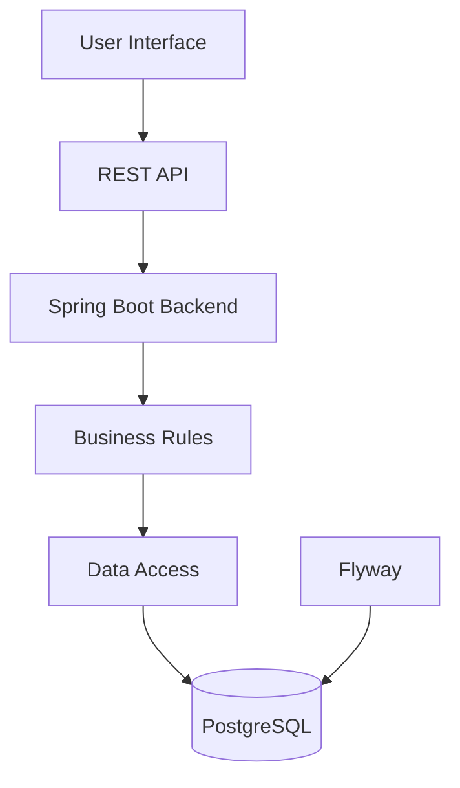
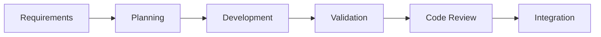

<h1 align="center">Enterprise ERP — B2B</h1>

  Enterprise Resource Planning System | VHC Soluções

  
  
  

---

## Overview | Visão geral

Sistema integrado de gestão empresarial desenvolvido
pela VHC Soluções, voltado à centralização de processos
financeiros, comerciais e operacionais.

The project focuses on enterprise management, modular
software architecture, data consistency and scalability.

## Tech Stack

---

## Business Modules

| Module | Description |
|---|---|
| Financial | Gestão financeira empresarial |
| Registration | Gerenciamento de cadastros |
| Inventory | Controle de estoque |
| CRM | Gestão de relacionamento com clientes |

## Architecture

Diagrama conceitual e simplificado da solução:

### Engineering Principles

- Multi-tenant architecture
- Modular software design
- REST API integration
- Database versioning
- Data isolation
- Authentication and authorization
- Technical documentation
- Version control

---

## My Responsibilities

Como responsável pela área técnica da VHC Soluções,
minhas atividades envolvem:

- Definição da arquitetura de software.
- Levantamento e análise de requisitos.
- Desenvolvimento e integração de funcionalidades.
- Modelagem de bancos de dados relacionais.
- Definição de regras de negócio.
- Configuração de ambientes de desenvolvimento.
- Gerenciamento de branches e pull requests.
- Testes, validação e diagnóstico de falhas.
- Documentação técnica.
- Desenvolvimento assistido por inteligência artificial.

---

## Development Workflow

## Project Status

- Current stage: Active development
- Environment: Local
- Graphical interface: Available
- Source code: Private

---

## Confidentiality

Este repositório possui finalidade exclusivamente
demonstrativa e profissional.

O código-fonte, as regras de negócio proprietárias
e as informações internas pertencem à VHC Soluções
e não são disponibilizados publicamente.

---

## Author

**Victor Hugo Motta Terraciano**

Software Developer & Co-founder at VHC Soluções

[GitHub Profile](https://github.com/zzovittin) |
[Company Website](https://vhcsolucoes.com.br)
